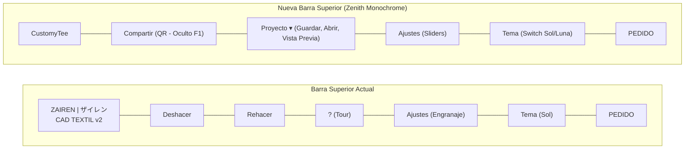

# Plan de Mejoras del Sistema — CustomyTee (CAD Textil)

> **Documento:** Auditoría y Plan Maestro de Evolución Integral  
> **Rama de integración:** `dev-mejoras`  
> **Rama del plan:** `fase-0-plan`  
> **Sistema de Diseño:** Zenith Monochrome (`DESIGN.md`)  
> **Entorno:** Cloudflare Pages (sitio estático, zero-build, módulos ES nativos)  
> **URL Producción:** [https://customytee.pages.dev](https://customytee.pages.dev)  
> **Fecha:** 27 de octubre de 2026

---

## 1. Verificación Inicial y Reglas de Trabajo

- **Estado de `main` y `dev-editor-svg`:**
  Se verificó con `git rev-parse main dev-editor-svg` que ambas ramas apuntan al commit `39cbf5d0b6b830a3658b8ce021aec38722e0d34b`. La versión v2 del editor con SVG paramétrico, cotas milimétricas y cifrado `.zrn` ya está completamente fusionada y desplegada en producción.
- **Rama de integración:** Se creó la rama `dev-mejoras` a partir de `main` y se publicó en `origin/dev-mejoras`.
- **Rama de trabajo Fase 0:** Se creó `fase-0-plan` desde `dev-mejoras`.
- **Estado de GitHub CLI (`gh auth status`):** No autenticado en el entorno local (`You are not logged into any GitHub hosts`). Se entregará para cada fase el comando de push, título, descripción completa y enlace de comparación para creación de Pull Request.
- **Seguridad:** Cero secretos, frases maestras ni contraseñas en código, documentos o commits.

---

## 2. Inventario Exhaustivo del Estado Actual

### 2.1. Inventario de Emojis y Símbolos (Archivo y Línea)

Se auditaron todos los archivos del repositorio con expresiones regulares Unicode (`\p{Extended_Pictographic}` y rangos de símbolos gráficos). Todos los elementos listados a continuación serán reemplazados por íconos de trazo vectoriales uniformes (Lucide) o texto accesible:

| Archivo | Línea | Símbolo(s) | Contexto actual | Reemplazo en Fase 1 |
|---|---|---|---|---|
| `index.html` | 339 | `⚠️` | Aviso de calidad < 150 DPI | Ícono Lucide `alert-triangle` SVG |
| `index.html` | 420 | `💾` | Botón Guardar Proyecto | Ícono Lucide `save` SVG |
| `index.html` | 423 | `📂` | Botón Abrir Proyecto | Ícono Lucide `folder-open` SVG |
| `index.html` | 473 | `👉` | Barra rápida manga: `👉 A MANGA DER` | Ícono Lucide `arrow-right` SVG + texto |
| `index.html` | 476 | `🪞` | Barra rápida manga: `🪞 ESPEJO: OFF` | Ícono Lucide `flip-horizontal` SVG + texto |
| `index.html` | 479 | `🎯` | Barra rápida manga: `🎯 CENTRO` | Ícono Lucide `crosshair` SVG + texto |
| `index.html` | 528 | `◀` | Ajuste fino móvil: Mover 1 mm Izquierda | Ícono Lucide `chevron-left` SVG |
| `index.html` | 533 | `▶` | Ajuste fino móvil: Mover 1 mm Derecha | Ícono Lucide `chevron-right` SVG |
| `index.html` | 542 | `🔒` | Bloquear proporción de capa | Ícono Lucide `lock` SVG |
| `index.html` | 666 | `🎨` | Modal recuperación: `🎨 Diseño anterior` | Ícono Lucide `palette` o `clock` SVG |
| `js/capas.js` | 330 | `🔒` / `🔓` | Botón de bloqueo de aspecto en capa | SVG inline Lucide `lock` / `unlock` |
| `js/main.js` | 243 | `👁️` | Mensaje de lectura en vista de polera | Ícono Lucide `eye` SVG o texto plano |
| `js/ui.js` | 737 | `🔒` / `🔓` | Toggle de bloqueo de aspecto | SVG inline Lucide `lock` / `unlock` |
| `js/ui.js` | 778 | `🪞` | Texto del botón espejo rápido | Ícono Lucide `flip-horizontal` SVG |
| `js/ui.js` | 985 | `👉` / `👈` | Switch dinámico de manga izq/der | Ícono Lucide `arrow-right` / `arrow-left` SVG |
| `js/ui.js` | 991 | `🪞` | Texto reactivo de espejo rápido | Ícono Lucide `flip-horizontal` SVG |
| `js/ui.js` | 1060 | `🎨` | Estado vacío de capas: icono central | Ícono Lucide `sparkles` o `layers` SVG |
| `js/ui.js` | 1064 | `📁` | Botón estado vacío: `📁 Subir Imagen` | Ícono Lucide `upload` SVG + texto |
| `js/ui.js` | 1065 | `🔤` | Botón estado vacío: `🔤 Añadir Texto` | Ícono Lucide `type` SVG + texto |
| `js/ui.js` | 1087 | `🔤` / `🖼️` | Distintivo de capa texto vs imagen | Ícono Lucide `type` / `image` SVG |
| `js/ui.js` | 1091 | `👁️` / `🚫` | Alternador de visibilidad de capa | Ícono Lucide `eye` / `eye-off` SVG |
| `js/ui.js` | 1092 | `🔒` / `🔓` | Alternador de candado de capa | Ícono Lucide `lock` / `unlock` SVG |
| `lector/configurar/configurar.js` | 43, 394 | `⚠️` | Alertas de contraseña / verificación | Ícono Lucide `alert-triangle` SVG |
| `lector/configurar/configurar.js` | 216, 389 | `✅` | Éxito en generación / verificación | Ícono Lucide `check-circle` SVG |
| `lector/configurar/configurar.js` | 380 | `❌` | Error de discrepancia de claves | Ícono Lucide `x-circle` SVG |
| `lector/configurar/configurar.js` | 398 | `🔍` | Botón verificar par de claves | Ícono Lucide `shield-check` SVG |
| `lector/configurar/index.html` | 104, 105, 106 | `🔑`, `🧠`, `🛡️` | Fichas de seguridad de 3 pilares | Íconos Lucide `key`, `cpu`, `shield` |
| `lector/configurar/index.html` | 200 | `🔍` | Botón verificar | Ícono Lucide `shield-check` SVG |
| `lector/index.html` | 129, 265 | `🟢`, `✅` | Estado clave lista | Ícono Lucide `circle-dot` SVG verde |
| `lector/index.html` | 132 | `🔒` | Botón bloquear clave | Ícono Lucide `lock` SVG |
| `lector/index.html` | 133 | `🔑` | Botón cambiar frase | Ícono Lucide `key` SVG |
| `lector/index.html` | 134 | `⚙️` | Enlace a configuración | Ícono Lucide `sliders` SVG |
| `lector/lector.js` | 62, 67 | `🟢`, `🔒` | Etiquetas de estado de clave | Texto claro con indicador de color CSS |
| `lector/lector.js` | 134, 437 | `⚠️` | Avisos de frase y seguridad | Contenedor de aviso con borde y estilo |
| `README.md` | 5, 6, 7, 104 | `🌐`, `🌿`, `🧪`, `👉` | Enlaces y viñetas del manual | Viñetas estándar Markdown |
| `docs/CLOUDFLARE.md` | 106, 132 | `⚠️`, `✅` | Título y checklist | Formato callout estándar Markdown |

### 2.2. Componentes de la Barra Superior Actual vs. Nueva Especificación

**Diferencias y Reubicaciones:**
1. **Logo y Título:** Se remueve el kanji `"ザイレン"` y el badge `"CAD TEXTIL v2"`. Queda únicamente `"CustomyTee"`.
2. **Deshacer y Rehacer:** Salen completamente de la cabecera superior:
   - **Escritorio:** Se sitúan al inicio de la barra superior de la mesa (`stage-toolbar-top`), inmediatamente a la izquierda del grupo "ALINEAR".
   - **Móvil:** Se ubican en una píldora flotante compacta sobre el lienzo de la mesa, garantizando un área de toque $\ge 44\text{ px}$.
3. **Botón "?" (Tour):** Sale de la barra superior. Se integra como la opción *"Ver guía de uso"* dentro del menú desplegable de Ajustes.
4. **Menú Proyecto:** Nuevo menú desplegable con opciones: *"Guardar mi proyecto"*, *"Abrir proyecto"* y *"Descargar vista previa (ZIP)"*.
5. **Ajustes:** Sustituye el ícono de engranaje por el de controles deslizantes (`sliders-horizontal`), diferenciándolo netamente del botón de tema. Contiene: *Unidad de medida*, *Fondo de mesa*, *Imanes*, *Cotas*, *Animaciones*, *Ver guía de uso* y *Soporte (Instagram)*.
6. **Tema:** Pasa de ser un ícono ambiguo a un interruptor corto de dos segmentos (Sol / Luna), con el modo activo claramente contrastado, atributo `aria-label="Tema: claro/oscuro"` y tooltip descriptivo.
7. **Responsive (360 px):** En pantallas pequeñas ($\le 420\text{ px}$), si la suma de botones excede el ancho útil, se agrupan Compartir, Ajustes y Tema dentro de un menú colapsable *"Más"* (`...`), preservando visibles siempre *"CustomyTee"*, *"Proyecto"* y *"PEDIDO"*.

### 2.3. Pasos Actuales del Tour (`js/tour.js`) vs. Nuevos 8 Pasos

**Pasos Actuales (6 pasos):**
1. `#canvasViewport`: Mesa CAD y Gestos Táctiles.
2. `#surfaceSwitcher`: Superficies y Patrón Plano de Mangas.
3. `#mobileTabPrenda` / `#panelSectionPrenda`: Talla y Color de Prenda.
4. `#mobileTabDiseno` / `#panelSectionDiseno`: Subir Diseño y Añadir Texto.
5. `#controlsPanel` / `#panelSectionCapas`: Hoja Deslizable en 3 Posiciones / Capas.
6. `#mobileTabPedido` / `#panelSectionPedido`: Múltiples Poleras y Envío Cifrado.

**Nuevos Pasos Reestructurados (Máximo 8 pasos claros y fluidos):**
1. **Mesa y Gestos Táctiles:** Arrastre con 1 dedo para mover prendas/elementos, 2 dedos para pellizco (zoom continuo 30%–800%) y doble toque para encuadrar.
2. **Superficies:** Conmutación rápida entre Anverso, Reverso, Manga Izquierda y Manga Derecha.
3. **Prenda, Talla y Color:** Selección de tallas M base (S–XXL) y paleta Zenith Monochrome.
4. **Subir Diseño o Texto:** Carga de gráficos en alta resolución y tipografías locales.
5. **Menú Proyecto:** Guardar en `.zrp`, abrir proyectos previos y descargar maquetas de vista previa.
6. **Compartir (QR):** Generación de código QR para compartir el enlace al instante.
7. **Pedido y Envío:** Desglose por tallas, notas de confección y generación de paquete `.zrn` y `.zrp`.
8. **Paso Final (Soporte):** Destaca el logotipo `"CustomyTee"` en la barra superior con el mensaje:
   > *"Esperamos que esta herramienta te sea de ayuda. Si tienes algún problema, escríbenos a soporte."*  
   Incluye botón interactivo hacia Instagram (`INSTAGRAM_URL`), apertura en nueva pestaña (`rel="noopener noreferrer"`) y la indicación: *"Desde ahí también puedes ver el número para enviar tu pedido."*

### 2.4. Textos con la Marca (Separación Estricta de Identidades)

| Elemento / Ubicación | Valor Actual | Nuevo Valor | Justificación |
|---|---|---|---|
| `<title>` en `index.html` | `ZAIREN — CAD Textil v2` | `CustomyTee — Personalizador Textil` | Cara al cliente |
| Logo barra superior | `ZAIREN \| ザイレン` | `CustomyTee` | Cara al cliente |
| Badge barra superior | `CAD TEXTIL v2` | *(Eliminado)* | Limpieza visual |
| `js/config.js: CONFIG.APP_NAME` | `ZAIREN CAD Textil` | `CustomyTee` | Identificador público de app |
| `js/config.js: CONFIG.URL_PUBLICA` | *(Inexistente)* | `https://customytee.pages.dev` | Enlace base público |
| `js/config.js: CONFIG.INSTAGRAM_URL` | *(Inexistente)* | `https://www.instagram.com/zairen.lab` | Enlace oficial a soporte |
| Texto demostración inicial (`ui.js:419, 427`) | `ZAIREN`, `ザイレン\nZAIREN` | `CustomyTee` | Texto de prueba público |
| Archivos generados: `especificaciones.txt` | `ZAIREN CAD TEXTIL v2` | `CustomyTee — Ficha Técnica` | Documento para cliente |
| Archivos generados: `LEEME.txt` | `ZAIREN CAD TEXTIL v2` | `CustomyTee — Vista Previa` | Documento para cliente |
| **Marca de agua en vista previa (`exportar.js`)** | `ZAIRENLAB` | **`ZAIRENLAB`** | **Se mantiene según regla** |
| **Portal y Lector administrativo (`/acceso`, `/lector`)** | `ZAIREN` | **`ZAIREN / ZAIRENLAB`** | **Se mantiene según regla** |
| **Mensaje de WhatsApp al taller (`cifrado.js`)** | `¡Hola ZAIRENLAB! ...` | **`¡Hola ZAIRENLAB! ...`** | **Se mantiene según regla** |
| **Perfil de Instagram oficial** | `@zairen.lab` | **`zairen.lab`** | **Se mantiene según regla** |

---

## 3. Hoja de Ruta Detallada Fase por Fase (Fases 1 a 7)

### FASE 1 — Rama `fase-1-marca-iconos`: Marca, Íconos y Barra Superior
1. **Marca:**
   - Barra superior izquierda muestra únicamente `CustomyTee`.
   - `<title>` pasa a `CustomyTee — Personalizador Textil`.
   - Textos de cara al cliente y archivos generados (`especificaciones.txt`, `LEEME.txt`, mockups) pasan a `CustomyTee`.
   - Se conservan como `ZAIRENLAB`: marca de agua de vista previa, `/acceso`, `/lector`, mensaje de WhatsApp y perfil de Instagram. Texto de demo: `"CustomyTee"`.
   - Nuevas constantes en `js/config.js`: `URL_PUBLICA = "https://customytee.pages.dev"`, `INSTAGRAM_URL = "https://www.instagram.com/zairen.lab"`.
   - Selector de prenda: ocultar menú mientras exista una sola prenda (mostrar solo "Polera"), conservando la reactividad multiprenda para el futuro.
2. **Íconos (Erradicación Total de Emojis):**
   - Buscar y reemplazar todos los emojis por íconos Lucide SVG inline/sprite con `stroke-width="1.8"`, `stroke="currentColor"`, `aria-hidden="true"` y `aria-label` en botones.
   - Ícono SVG propio para Instagram.
   - Nueva suite `tests/sin-emojis.mjs` que evalúe con `\p{Extended_Pictographic}` y falle si queda algún emoji en archivos publicados.
3. **Barra Superior Nueva:**
   - Derecha: `Compartir` (oculto hasta Fase 4), `Proyecto` (menú con Guardar, Abrir y Descargar maqueta), `Ajustes` (sliders), `Tema` (switch sol/luna), `PEDIDO`.
   - `?` se retira de la cabecera (se aloja en Ajustes como "Ver guía de uso" y "Soporte Instagram").
   - Deshacer/Rehacer: escritorio al inicio de la barra de mesa; móvil en píldora flotante.
   - Contención responsive en 360 px con menú "Más" y metas táctiles $\ge 44\text{ px}$.

### FASE 2 — Rama `fase-2-mangas-pulido`: Arreglos y Pulido Visual
1. **Bug de Manga Izquierda:**
   - Desacoplar la aplicación redundante de rotación y escala de `gestorTexto.dibujarCapa` dentro de `proyectarDisenosEnMangaPerspectiva`.
   - Corregir el mapeo de coordenadas anatómicas vs visuales para que con dos diseños independientes en cada manga y sin modo espejo, ambos textos e imágenes se lean derechos, legibles y proporcionales en anverso y reverso para todas las tallas.
   - Pruebas de regresión añadidas a `tests/mangas-aislamiento.test.mjs`.
2. **Zoom Inicial y Encuadre con Cuello Visible:**
   - En `js/mesa.js`, recalcular `ajustarAPantalla()` para encuadrar la silueta completa (desde $y = -2\text{ cm}$ hasta $y = 71\text{ cm}$) con margen superior seguro, evitando que el cuello quede fuera del viewport.
3. **Pestaña Pedido:**
   - Crear clase `.btn-secondary` en `css/styles.css` con contraste formal AA y maquetar los botones Guardar y Abrir proyecto sin solapamientos.
4. **Mangas y Cuello (Fichas Bloqueadas):**
   - Fichas bloqueadas con ícono de candado Lucide y tooltip: `"Se iguala al color de la prenda"`.
5. **Estado Vacío y Pulido Visual:**
   - Renovar estado vacío de capas con íconos vectoriales.
   - Ajustar tipografía mínima $\ge 12\text{ px}$, espaciados en múltiplos de 8 px, estados de foco y barra HUD inferior legible en 360, 390, 768 y 1280 px.

### FASE 3 — Rama `fase-3-proyecto-zrp`: Archivo de Proyecto `.zrp`
1. **Formato `.zrp`:**
   - Contenedor ZIP (JSZip de cdnjs) con `proyecto.json` y carpeta `imagenes/`. Metadatos completos por polera y superficies. Soporte para proyectos de solo texto.
2. **Guardado y Envío:**
   - Botón *"Guardar mi proyecto"* en menú `Proyecto` y pestaña `Pedido`.
   - Al enviar pedido: descarga conjunta de `.zrn` y `.zrp` con el mismo código. En móvil, Web Share API para ambos archivos o modal de confirmación con enlaces independientes.
3. **Apertura e Importación Segura:**
   - Botón *"Abrir proyecto"* y drag & drop. Validación de firma ZIP PK y compatibilidad retroactiva con `.json`.
   - Límites: 60 MB total, 25 MB por imagen, 50 capas. Anti-path traversal (sin `..`). SVGs tratados estrictamente como `` o Blob binario (sin innerHTML).
4. **Diálogo de Importación:**
   - Opciones: *"Reemplazar el trabajo actual"* (con deshacer) o *"Añadir como nueva polera"*.
5. **Intercepción de `.zrn`:**
   - Si se intenta abrir un `.zrn`, mensaje explicativo amigable indicando que es para el taller y que use su `.zrp`.
6. **Puente con `/lector`:**
   - Botón *"Abrir en el editor"* tras descifrar en `/lector`, transfiriendo el proyecto vía IndexedDB y redirección al editor con misma validación.
7. **Pruebas Automatizadas:**
   - Nueva suite `tests/proyecto-zrp.test.mjs` con pruebas de ida/vuelta, corrupción, límites y rechazo de `.zrn`.

### FASE 4 — Rama `fase-4-qr`: Compartir con Código QR
1. **Activación:** Botón `Compartir` con ícono QR en la barra superior.
2. **Modal Responsive:** Modal centrado en escritorio y hoja inferior en móvil, con foco atrapado y cierre con Esc.
3. **Generador QR Local:** Librería ligera de cdnjs fija. Renderizado en canvas: módulos negros sobre fondo blanco estricto, margen de 4 módulos, nivel M, sin logo y apuntando siempre a `URL_PUBLICA`.
4. **Acciones:** Campo de enlace con botón "Copiar" (aviso "Copiado"), botón "Compartir" (`navigator.share`) y botón "Descargar QR" (PNG 1024 px).
5. **Pruebas:** `tests/qr.test.mjs`.

### FASE 5 — Rama `fase-5-animaciones`: Animaciones Minimalistas Estilo Apple
1. **Tokens CSS:** Duraciones 120, 200 y 320 ms con curvas iOS `cubic-bezier(0.32, 0.72, 0, 1)`.
2. **Propiedades Aisladas:** Animación estricta de `transform` y `opacity` en modales, hojas, pestañas, toasts y pulsación de botones (press scale 0.97). Cero transiciones sobre el contenido del canvas durante manipulación activa (60 fps garantizados).
3. **Accesibilidad:** Soporte `prefers-reduced-motion` y conmutador *"Animaciones"* en Ajustes.
4. **Pruebas:** `tests/animaciones.test.mjs`.

### FASE 6 — Rama `fase-6-tour`: Guía de Uso (Driver.js)
1. **Tour de 8 Pasos:** Recorrido interactivo con apertura sincronizada de hojas en móvil.
2. **Paso Final:** Apunta a `CustomyTee` con mensaje de agradecimiento y botón directo a Instagram (`INSTAGRAM_URL`, nueva pestaña, `rel="noopener noreferrer"`).
3. **Persistencia:** Solo primera visita; repetible desde Ajustes > "Ver guía de uso".
4. **Integración:** Enlace a Instagram en Ajustes y en la confirmación de pedido.
5. **Pruebas:** `tests/tour.test.mjs`.

### FASE 7 — Rama `fase-7-cierre`: Auditoría Final y Cierre
1. **Batería E2E:** 9 comprobaciones obligatorias ejecutadas y reportadas con evidencia.
2. **Documentación:** Actualización de `README.md` y `estado-proyecto-cad-textil-v2.md` sin secretos.
3. **PR Borrador:** Creación del PR borrador de `dev-mejoras` hacia `main` (sin fusionar).

---

## 4. Orden de Commits Previsto (30 commits)

1. `docs(plan): auditoria integral, inventario de emojis y plan maestro en PLAN-mejoras.md` *(Ejecutado)*
2. `feat(config): agregar constantes URL_PUBLICA e INSTAGRAM_URL y renombrar app a CustomyTee`
3. `feat(marca): actualizar textos publicos, logo y selector de prenda a CustomyTee`
4. `feat(iconos): integrar sprite e iconos Lucide SVG eliminando emojis en componentes y vistas`
5. `feat(navegacion): reestructurar barra superior con menu proyecto, ajustes, switch sol-luna y pedido`
6. `feat(mesa): reubicar deshacer y rehacer en barra de mesa en escritorio y pildora flotante movil`
7. `test(iconos): agregar suite sin-emojis.mjs para verificar ausencia total de emojis en archivos publicados`
8. `fix(mangas): corregir proyeccion y mapeo plano de mangas eliminando deformacion en anverso y reverso`
9. `fix(mesa): ajustar calculo de zoom inicial y encuadre completo de prenda con cuello visible`
10. `style(pedido): corregir maquetacion y contraste de botones guardar y abrir proyecto en claro y oscuro`
11. `feat(ui): transformar fichas de mangas y cuello a estado bloqueado con candado y tooltip explicativo`
12. `style(ui): pulido visual responsivo en 360-1280px con contraste AA, espaciado de 8px y estados vacios`
13. `test(mangas): agregar pruebas de regresion para doble diseno en mangas, espejo y volteo`
14. `feat(zrp): implementar empaquetado y lectura de archivo ZIP .zrp con proyecto.json e imagenes`
15. `feat(zrp): integrar dialogos de reemplazo de trabajo o adicion como nueva polera al importar`
16. `feat(seguridad): anadir validacion por contenido, rechazo amigable de .zrn y limites de seguridad`
17. `feat(pedido): descargar conjuntamente .zrn y .zrp al confirmar pedido con Web Share y fallback`
18. `feat(lector): agregar boton abrir en el editor en panel administrativo via indexeddb`
19. `test(zrp): crear suite de pruebas unitarias para ciclo de vida guardar-abrir de .zrp`
20. `feat(qr): integrar generador local de codigo QR nivel M con descarga PNG 1024px y copia de enlace`
21. `feat(ui): implementar modal responsive de compartir con animacion tipo hoja en movil`
22. `test(qr): verificar generacion de QR, direccionamiento estricto a URL_PUBLICA y contraste`
23. `style(animaciones): definir tokens de movimiento 120/200/320ms con curvas bezier tipo iOS`
24. `style(animaciones): animar transform y opacity en modales, hojas, pestanas y botones`
25. `feat(ajustes): anadir interruptor de animaciones y soporte para prefers-reduced-motion`
26. `feat(tour): reestructurar recorrido interactivo en 8 pasos con apertura coordinada de hojas en movil`
27. `feat(tour): agregar paso final con agradecimiento y boton de soporte hacia Instagram`
28. `feat(ui): enlazar reinicio de guia y enlace a Instagram en ajustes y confirmacion de pedido`
29. `test(cierre): ejecutar suite completa de 9 verificaciones con evidencia`
30. `docs: actualizar README y estado-proyecto-cad-textil-v2.md con arquitectura final sin secretos`

---

## 5. Preguntas Abiertas para Alineación

1. **Librería de código QR (Fase 4):** Para generar el QR en el cliente, ¿prefieres `qrious` (~8 KB, ultra-ligera y basada en canvas) o `qrcode-generator` (~14 KB, clásica y ampliamente testeada), ambas en cdnjs?
2. **Interruptor de Tema (Fase 1):** ¿Prefieres que el switch sol/luna sea un control segmentado doble (con sol a la izquierda y luna a la derecha, resaltando el modo activo) o un botón compacto de un solo toque con indicador de modo actual y tooltip?
3. **Botones de Guardar/Abrir Proyecto en Pestaña Pedido (Fase 1 y 3):** Al mover estas acciones al nuevo menú *"Proyecto"* de la barra superior, ¿deseas mantener también botones de acceso secundario en la pestaña *"4. PEDIDO"*, o prefieres despejar la pestaña y centralizarlos únicamente en la barra superior?
4. **Denominación del `.zrp` dentro del paquete `.zrn` (Fase 3):** ¿Confirmas que dentro del `.zrn` el proyecto se empaquete con el nombre exacto `CustomyTee-Pedido-<codigo>.zrp`?
5. **Comportamiento del Selector de Prenda con 1 Elemento (Fase 1):** Cuando solo exista "Polera", ¿prefieres ocultar por completo el contenedor (`display: none`) o mostrar una ficha de texto informativa estática "Prenda: Polera"?
